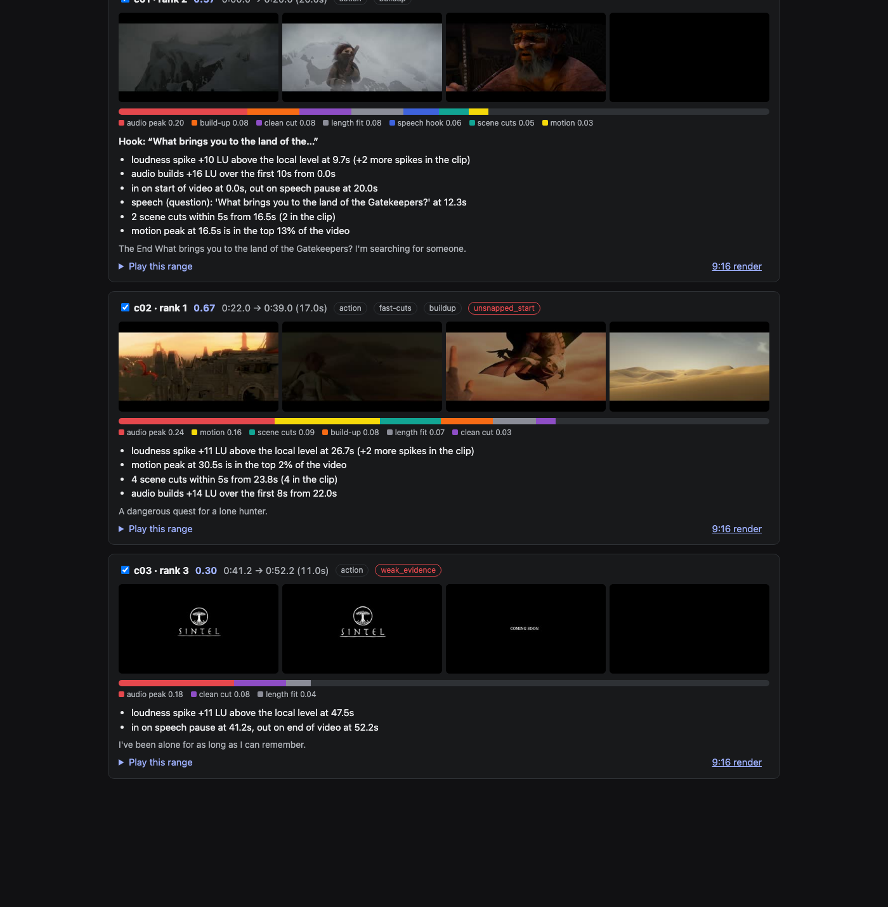
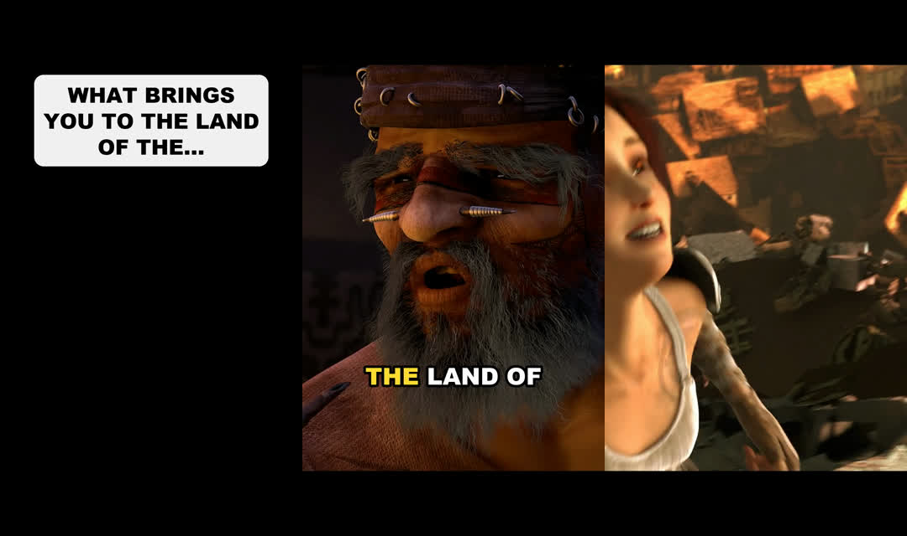
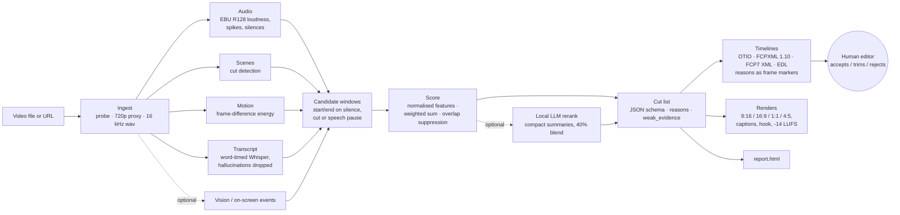

# Luter Video Agent (LVA)

**An explainable AI video agent. It finds the best moments in long footage from measured signals, and hands them to a human editor as an editable timeline in which every cut carries the reason it was chosen.**


> **About this repository.** This is a public **showcase**: documentation, architecture, screenshots and real example outputs. The source code (about 4,200 lines of Python plus 1,600 lines of tests) is in a **private** repository. Reviewers can get read access on request (use the contact details in my application).

---

## Why it matters: an agent whose decisions you can audit

Most AI clipping tools transcribe a video, ask an LLM which lines are "good", and return finished MP4s. You can't see why a clip was picked, and you can't correct the machine without starting over.

LVA is built around the opposite principle:

| Principle | How LVA does it |
|---|---|
| **No unexplained decisions** | Every clip comes with `reasons[]`, and each reason quotes a measurement with a timestamp, e.g. `loudness spike +10 LU above the local level at 9.7s`. The score is a visible weighted sum (`score_breakdown`). |
| **No overclaiming** | Clips backed by fewer than two real signals are flagged `weak_evidence` instead of being presented as strong picks. |
| **Human stays in control** | Output is a timeline for DaVinci Resolve, Premiere or Final Cut, with the reasons placed as **markers on the exact frames**. The editor accepts, trims or rejects; nothing is final until a human says so. |
| **LLMs advise, they don't decide** | The optional local-LLM rerank sees only a compact summary of each candidate (under 4k tokens; never the full transcript) and is blended in at 40%, so measured evidence still dominates. |
| **Private by default** | Runs fully offline on a laptop (Apple Silicon). No API key is needed for anything up to and including captioned vertical clips. |
| **Built for agents** | One CLI call returns one JSON document; a skill file and a 6-tool plugin let even a small local model drive the full pipeline. |

The same design questions apply to any AI agent acting for a person: *what did it decide, on what evidence, and can a human check and override it?*

---

## Demo

**Contact sheet (`report.html`)** from a real run on the *Sintel* trailer: picked clips, score breakdown bars, measured reasons, the transcript, and a `weak_evidence` flag on clip 3.



**Rendered 9:16 clips**: hook title, word-timed captions, loudness normalised to -14 LUFS.



Real outputs from that run are in [`examples/`](examples):
- [`sintel-cutlist.json`](examples/sintel-cutlist.json): the picks, with in/out times, score breakdown, reasons, caption words and markers
- [`sintel_trailer_1080p_lva.otio`](examples/sintel_trailer_1080p_lva.otio): the OpenTimelineIO timeline for DaVinci Resolve
- [`sintel_trailer_1080p_lva.markers.edl`](examples/sintel_trailer_1080p_lva.markers.edl): the marker list

An excerpt from the cut list:

```json
{
  "id": "c01", "in_s": 0.0, "out_s": 20.0, "score": 0.5683,
  "score_breakdown": { "audio_peak": 0.1975, "buildup": 0.08, "clean_cut": 0.08,
                       "duration_fit": 0.08, "speech_hook": 0.055,
                       "scene_density": 0.0457, "motion": 0.0301 },
  "reasons": [
    "loudness spike +10 LU above the local level at 9.7s (+2 more spikes in the clip)",
    "audio builds +16 LU over the first 10s from 0.0s",
    "in on start of video at 0.0s, out on speech pause at 20.0s",
    "speech (question): 'What brings you to the land of the Gatekeepers?' at 12.3s",
    "2 scene cuts within 5s from 16.5s (2 in the clip)",
    "motion peak at 16.5s is in the top 13% of the video"
  ],
  "hook_text": "What brings you to the land of the…"
}
```

---

## Architecture



**How a clip is scored**
1. **Signals:** loudness curve, scene cuts, per-second motion energy and a word-timed transcript.
2. **Windows:** every 15–60 s span that starts and ends on a natural boundary (silence, cut or speech pause).
3. **Features:** each normalised 0–1 for this video: audio peak, build-up, motion, cut density, speech hooks, clean cut points and length fit.
4. **Score:** a weighted sum with presets for `gameplay`, `podcast`, `tutorial` and `ad`, all configurable in YAML. Overlapping windows are suppressed.
5. **Reasons:** each one quotes the measurement that produced it.

---

## Interfaces

```text
lva run <file|url>     ingest → signals → cut list → exports (→ renders, report)
lva analyze <id>       transcript, audio, scenes, motion (cached)
lva cutlist <id>       re-score in ~1 s with another preset / length / count
lva pick <id> --ids …  keep exactly the clips a human chose
lva export <id>        otio, xmeml, fcpxml, edl
lva render <id>        9:16, 16:9, 1:1, 4:5 with smart / crop / blur / pad framing
lva rerank <id>        optional local-LLM reorder
lva eval <id>          precision@k against human-marked moments
lva validate <file>    schema and sanity check
```

- **Agent plugin** (Hermes Agent): `lva_run`, `lva_ingest`, `lva_analyze`, `lva_cutlist`, `lva_export`, `lva_render`. It passes the plugin linter (`hermes plugins doctor --ci`).
- **Skill file**, written so a small local model can run the whole flow.

---

## Verification

| Status | Check |
|---|---|
| ✅ | **205 automated tests pass** (3 skipped by design), re-run 25 Nov 2026. They cover rational time maths at 23.976 / 25 / 29.97 (drop- and non-drop-frame) / 59.94 fps, frame-for-frame agreement across all four exporters, and OTIO / FCP7 XML / EDL round-trips through the OpenTimelineIO adapters. Renders are checked for exact frame count and -14 LUFS loudness. |
| ✅ | Sintel trailer end to end, including three captioned vertical renders: **34 s** on an M1 Pro. |
| ✅ | 10½-minute 1080p60 gameplay video with commentary, transcription included: **103 s**. |
| ✅ | Local-LLM rerank, live: 18/18 candidates scored by a 9B local model in 45 s. |
| ⬜ | Import inside DaVinci Resolve and Premiere Pro (verified through OpenTimelineIO only so far). |
| ⬜ | Pick quality against a human-marked golden set (the `lva eval` tool is built; the human labels are pending). |

**Honest limits:** LVA measures; it doesn't understand. A loud, busy, pointless stretch can outrank a quiet, clever one. That's why the reasons are shown, the human approves every cut, and a golden-set evaluation is built in.

---

## Prior art

Checked before building: open-source clippers (PeakCut, arena and others) return rendered MP4s picked mainly from the transcript. Timeline libraries (ChatOctopus/timeline) convert formats but don't pick moments. Premiere MCP servers act inside the editor but need a cut list from somewhere. LVA fills the gap between them: **measured picks + per-cut reasons + an editable timeline**.

---

## Stack

Python 3.10+ · ffmpeg (EBU R128, scene detection) · mlx-whisper (on-device speech-to-text) · OpenTimelineIO · Pillow (caption rendering) · JSON Schema · pytest · optional Ollama / OpenAI-compatible LLM for rerank.

## Author

**Martin Akumba**, cybersecurity analyst (Abuja, Nigeria), building AI agents with a focus on safety, auditability and least-privilege design.

## Licence and credits

© 2026 Martin Akumba. **All rights reserved.** Shared for evaluation only; see [LICENSE](LICENSE).
Demo frames: *Sintel* © Blender Foundation, [durian.blender.org](https://durian.blender.org), CC BY 3.0.
